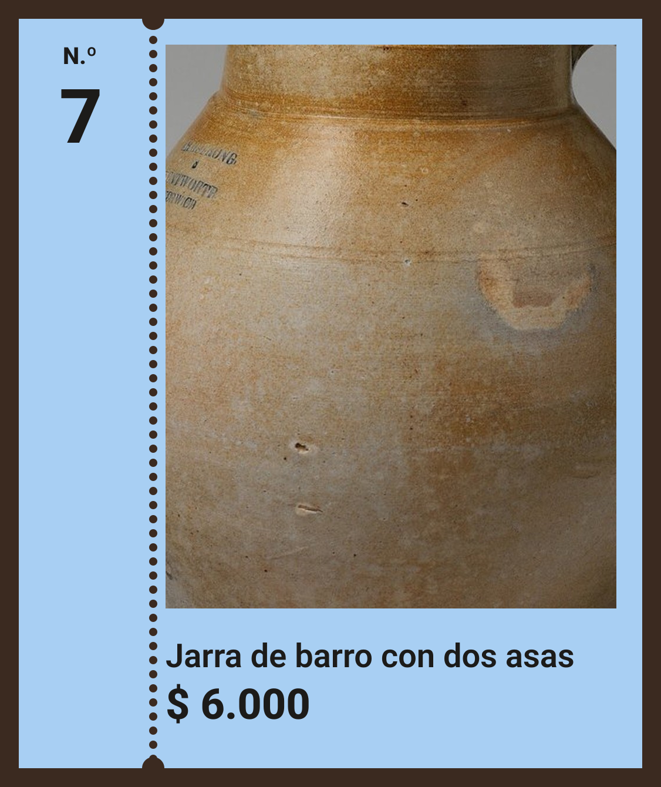
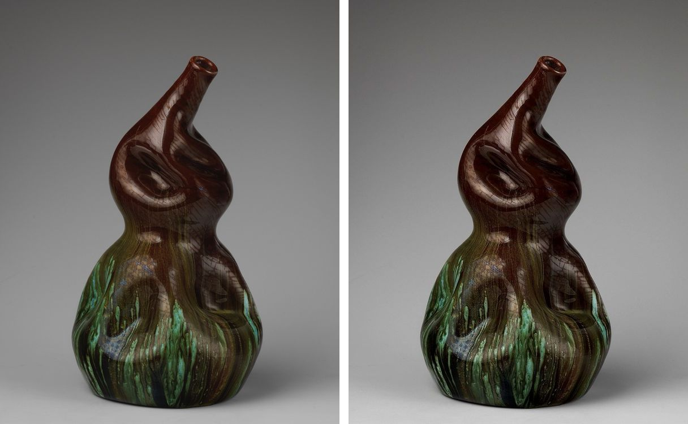

# Taller de Norma

Norma tiene 70 años, hace cerámica y solo usa WhatsApp. Para publicar una pieza le saca una foto, manda un audio diciendo qué es y cuánto sale, y toca "Sí". La pieza aparece en su página con un número, para que después pueda decir "vendí la 7".

**Página:** [taller-de-norma.vercel.app](https://taller-de-norma.vercel.app)

Demo de dos minutos: publicar una pieza por WhatsApp y verla en la página.

https://github.com/user-attachments/assets/d8ce428b-61bb-4f95-ac48-3604f9de399a

## Cómo funciona

1. Norma manda una foto. El bot la gira si salió acostada, la recorta al formato de la página y le corrige la luz y la nitidez, sin inventar nada de la pieza.
2. Manda un audio: "taza azul, seis mil". También puede escribirlo, o mandar el audio primero.
3. El bot le devuelve la boleta tal como se va a ver en la página, con dos botones: "Sí, publicar" y "No, corregir".
4. Con "Sí", la pieza queda publicada con el número siguiente.



Después, por audio o por texto:

| Norma dice                         | Qué pasa                                                    |
| ---------------------------------- | ----------------------------------------------------------- |
| "Vendí la 7" o "sacá la taza azul" | La pieza deja de verse. El bot ofrece "Deshacer".           |
| "La 7 ahora sale ocho mil"         | Vista previa con el cambio: "Antes $ 6.000, ahora $ 8.000". |
| Una foto nueva y "esta es la 7"    | Vista previa con la foto nueva.                             |
| "Deshacer"                         | Vuelve atrás la última acción.                              |
| Cualquier otra cosa                | Un audio grabado le explica qué puede hacer.                |

Solo los números autorizados administran el taller. Un mensaje de cualquier otro número se descarta sin respuesta.

## Probarlo en tu máquina

Necesitás Node 24 y pnpm. Sin claves ni base de datos:

```sh
pnpm install
pnpm dev    # la página en localhost:3000, con piezas de muestra
pnpm sim    # el bot en la terminal: escribís como Norma y ves qué responde
```

`pnpm sim` usa los dobles en memoria: no manda mensajes ni guarda nada. Para conectar WhatsApp, Supabase, Claude y Groq, copiá `.env.example` a `.env.local`. Cada variable dice de dónde sale.

| Comando                                            | Qué hace                                                                        |
| -------------------------------------------------- | ------------------------------------------------------------------------------- |
| `pnpm test`                                        | Tests unitarios                                                                 |
| `pnpm test:e2e`                                    | La página en un navegador: axe, zoom al 200 %, 320 px de ancho y sin JavaScript |
| `pnpm lint`, `pnpm typecheck`, `pnpm format:check` | Lo mismo que corre CI                                                           |
| `pnpm eval`                                        | Pasa 34 frases escritas por el intérprete real                                  |
| `pnpm eval:audio`                                  | Pasa los audios de prueba por el transcriptor y el intérprete reales            |
| `pnpm eval:photos`                                 | Trata las fotos de muestra y guarda cada par de original y tratada              |

## Mediciones

- **Página accesible (R12):** cero violaciones de axe en nivel AAA y contraste de 7:1 o más. Lighthouse en celular: rendimiento 98, accesibilidad 100, buenas prácticas 96 y SEO 100 (mediana de tres corridas). CI corta cualquier PR que baje de 95.
- **Audio confiable (R14):** 17 de 21 audios dan nombre y precio exactos (meta: 19). Los 21 precios salen bien; los errores son nombres mal oídos, como "Bowe celeste", que Norma corrige en la vista previa. Detalle en [ADR 0003](docs/adr/0003-transcripcion-separada-de-interpretacion.md). Los audios son voces reales y no están en el repo: para repetir la medición, grabá cada frase de [evals/audios.json](evals/audios.json) en `evals/audios/`.
- **Fidelidad de la foto (R17):** el tratamiento solo gira, recorta y ajusta luz y nitidez: no agrega ni reemplaza nada de la pieza. Original a la izquierda, tratada a la derecha:



## Cómo está armado

Un solo proyecto Next.js en Vercel sirve la página y recibe el webhook de WhatsApp. Los datos y las fotos van a Supabase.

```
src/domain/    reglas puras: qué intención es cada mensaje, qué responde el bot
src/ports/     lo que el dominio necesita de afuera: Messenger, Transcriber, Interpreter, Catalog…
src/adapters/  una implementación real y un doble en memoria por puerto
src/app/       la página pública y el webhook; solo conectan puertos con el dominio
```

El audio pasa primero por Whisper (en Groq) y el texto resultante por Claude Haiku, que devuelve una intención validada con Zod. Lo que Norma escribe entra directo al segundo paso, así que audio y texto dan el mismo resultado.

Para leer más:

- [docs/prd.md](docs/prd.md): qué entra, qué queda afuera y por qué.
- [GLOSSARY.md](GLOSSARY.md): el vocabulario del dominio (pieza, vista previa, deshacer).
- [docs/adr/](docs/adr/): las decisiones que alguien nuevo cuestionaría.
- [DESIGN.md](DESIGN.md): el sistema visual de la página.

## Qué hizo la IA y qué se decidió a mano

El código, los tests y casi toda la documentación los escribió Claude Code, un issue y un PR por vez, con las skills de [.claude/skills](.claude/skills).

Las decisiones fueron humanas: qué entra y qué queda afuera del PRD, cada regla del dominio, la dirección visual de la página y la revisión de cada PR que toca una zona de peligro (webhook, datos, modelo, secretos, legibilidad). La lista está en [CLAUDE.md](CLAUDE.md).

Dentro del producto, la IA hace solo dos cosas: Whisper pasa el audio a texto y Claude Haiku saca de ese texto el nombre y el precio. La foto se ajusta con procesamiento clásico de imagen (la librería `sharp`), sin IA generativa: la pieza que se ve es la que el comprador recibe.

## Licencia

[MIT](LICENSE). Las fotos de muestra son de The Metropolitan Museum of Art, de dominio público.
